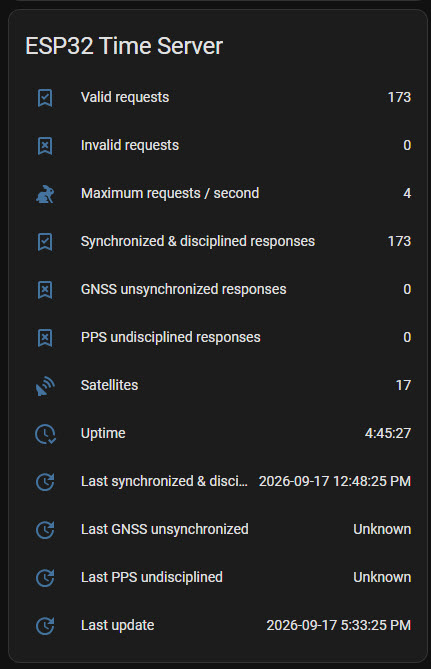
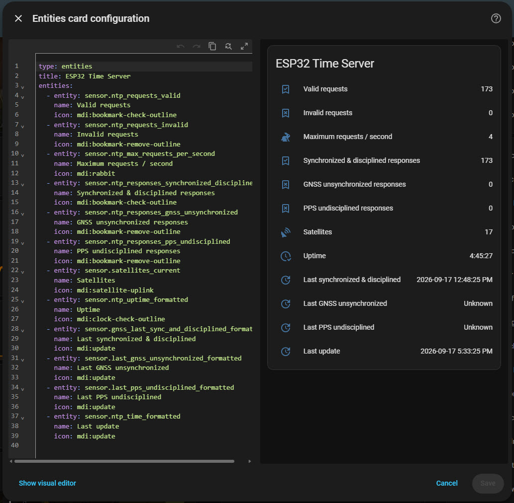

# ESP32 Time Server — Home Assistant Dashboard Card Setup

This guide covers how to integrate the ESP32 Time Server with Home Assistant and
display a status dashboard card. It is **not** an exhaustive write-up; it is
intended to get things up and running within an already existing Home Assistant
implementation.

The steps covered are:

1. Install and configure the Mosquitto MQTT broker add-on
2. Configure `mqtt.yaml` with the ESP32 Time Server sensors
3. Update `configuration.yaml` with an MQTT reference and template sensors
4. Reload the Home Assistant YAML configuration
5. Add a dashboard entity card

When complete, your dashboard will include a card like this:



---

## Step 1: Install the Mosquitto MQTT Broker

The ESP32 Time Server publishes its status data over MQTT. Home Assistant needs
a running MQTT broker to receive those messages.

The recommended broker for Home Assistant is the Mosquitto broker add-on. Follow
the official Home Assistant documentation to install and configure it before
continuing:

- **MQTT integration overview:**
  <https://www.home-assistant.io/integrations/mqtt/>
- **Mosquitto broker add-on:**
  <https://github.com/home-assistant/addons/blob/master/mosquitto/DOCS.md>

Once the Mosquitto broker is running and the MQTT integration is connected to
it, proceed to Step 2.

---

## Step 2: Configure mqtt.yaml

The MQTT sensors tell Home Assistant how to extract individual values from the
JSON payload that the ESP32 Time Server publishes to the
`ESP32TimeServer/report` topic.

Choose **one** of the three options below based on your current setup. After
completing this step, proceed to the matching option in Step 3.

The PTP sensors below combine
[Layer 2 and multicast UDP PTP](../misc/PTP_transports.md).
They require firmware with both MQTT reporting and at least one PTP service
enabled. Host checks validate generated reports; physical broker delivery and
on-device synchronization remain pending validation.
They count distinct recently active E2E requesters observed through accepted
`Delay_Req`, not selected/servo-locked followers or passive multicast listeners.
Identities use transport, domain, `clockIdentity`, and `portNumber`; defaults
are 32 identities per enabled transport and 30 seconds of inactivity. The
same requester over IPv4 and IPv6 counts twice; its source MAC is listed once.
A full table
ignores new identities; `this_period.ptp.follower_overflow_drops` reports
undercount risk. See the [JSON contract](../misc/esp32timeserver_json_doc.md)
for lifecycle, extrema, and frozen queued-report semantics.

NTP client details now live at `this_period.ntp.clients` and
`this_period.ntp.clients_overflown`; update existing templates that used
`this_period.clients` or `this_period.clients_overflown`.
PTP reports also include `this_period.ptp.clients`, independently of the NTP
client-reporting switch. Each record contains the actual Ethernet source `mac`
(for example `00:f1:b2:d2:ca:9a`) and `active_entire_period`. The latter is
true only if that MAC remained tracked continuously across the entire period;
new arrivals, departures, and rejoins are false. Multiple PTP identities with
the same MAC produce one record. At most `MQTT_PTP_CLIENT_REPORT_LIMIT` unique
MACs (default 96) are reported: all entire-period MACs (at most 96 with all
three PTP transports enabled),
followed by available first-come-first-served entries. Overflow of this
reporting list does not affect service. NTP client lists are likewise capped by
`MQTT_NTP_CLIENT_REPORT_LIMIT` (default 256). These are observed-request
activity records, not proof of clock lock. The JSON contract describes expiry
and queued-report semantics.

NTP-only or older reports omit PTP data; absent/null fields make these sensors
unavailable, not zero. A genuine zero remains available. In a PTP-only setup,
omit NTP request/response/client sensors and their derived template sensors and
dashboard entries; the PTP templates need no `ntp` object. Shared GNSS/PPS
indicators are not a PTP readiness or clock-lock measurement: NTP can remain in
holdover while PTP withdraws. Examples retain the default
`ESP32TimeServer/report` topic; change every topic consistently if customized.

### A — Create a new mqtt.yaml file

Use this option if you do **not** already have an `mqtt.yaml` file.

1. Create a new file called `mqtt.yaml` in your Home Assistant configuration
   directory (the same folder that contains `configuration.yaml`).
2. Add the following content:


```yaml

  sensor:
    # ============================
    # CURRENT
    # ============================
    - name: "NTP Time"
      state_topic: "ESP32TimeServer/report"
      value_template: "{{ value_json.current.time }}"

    - name: "NTP Uptime"
      state_topic: "ESP32TimeServer/report"
      value_template: "{{ value_json.current.uptime }}"
      unit_of_measurement: "s"

    - name: "Ethernet Up"
      state_topic: "ESP32TimeServer/report"
      value_template: "{{ value_json.current.ethernet_up }}"

    - name: "GNSS Synchronized"
      state_topic: "ESP32TimeServer/report"
      value_template: "{{ value_json.current.gnss_synchronized }}"

    - name: "GNSS Locked"
      state_topic: "ESP32TimeServer/report"
      value_template: "{{ value_json.current.gnss_synchronized_indicators.locked }}"

    - name: "GNSS Timing Valid"
      state_topic: "ESP32TimeServer/report"
      value_template: "{{ value_json.current.gnss_synchronized_indicators.timing }}"

    - name: "GNSS GPS Valid"
      state_topic: "ESP32TimeServer/report"
      value_template: "{{ value_json.current.gnss_synchronized_indicators.gps_valid }}"

    - name: "GNSS Sync Fresh"
      state_topic: "ESP32TimeServer/report"
      value_template: "{{ value_json.current.gnss_synchronized_indicators.sync_fresh }}"

    - name: "GNSS Sanity Check Passed"
      state_topic: "ESP32TimeServer/report"
      value_template: "{{ value_json.current.gnss_synchronized_indicators.sanity_check_passed }}"

    - name: "PPS Disciplined"
      state_topic: "ESP32TimeServer/report"
      value_template: "{{ value_json.current.pps_disciplined }}"

    - name: "PPS Signals Present"
      state_topic: "ESP32TimeServer/report"
      value_template: "{{ value_json.current.pps_disciplined_indicators.pps_signals_present }}"

    - name: "PPS Discipline Active"
      state_topic: "ESP32TimeServer/report"
      value_template: "{{ value_json.current.pps_disciplined_indicators.discipline_active }}"

    - name: "PPS Synchronized"
      state_topic: "ESP32TimeServer/report"
      value_template: "{{ value_json.current.pps_disciplined_indicators.pps_synchronized }}"

    - name: "Satellites Current"
      state_topic: "ESP32TimeServer/report"
      value_template: "{{ value_json.current.satellites }}"

    # ============================
    # MEMORY
    # ============================
    - name: "Malloc DMA"
      state_topic: "ESP32TimeServer/report"
      value_template: "{{ value_json.current.memory.malloc_cap_dma }}"

    - name: "Free Heap"
      state_topic: "ESP32TimeServer/report"
      value_template: "{{ value_json.current.memory.free_heap }}"

    - name: "Minimum Free Heap"
      state_topic: "ESP32TimeServer/report"
      value_template: "{{ value_json.current.memory.minimum_free_heap }}"

    - name: "Largest Free 8-bit Block"
      state_topic: "ESP32TimeServer/report"
      value_template: "{{ value_json.current.memory.largest_free_8bit_block }}"

    # ============================
    # QUEUED MESSAGES
    # ============================
    - name: "Queued Held"
      state_topic: "ESP32TimeServer/report"
      value_template: "{{ value_json.queued_messages.held }}"

    - name: "Queued Discarded"
      state_topic: "ESP32TimeServer/report"
      value_template: "{{ value_json.queued_messages.discarded }}"

    # ============================
    # THIS PERIOD
    # ============================
    - name: "Ethernet Up Seconds"
      state_topic: "ESP32TimeServer/report"
      value_template: "{{ value_json.this_period.ethernet_up_secs }}"
      unit_of_measurement: "s"

    - name: "PPS Pulses"
      state_topic: "ESP32TimeServer/report"
      value_template: "{{ value_json.this_period.pps_pulses }}"

    - name: "GNSS Locked Seconds"
      state_topic: "ESP32TimeServer/report"
      value_template: "{{ value_json.this_period.gnss_locked_secs }}"
      unit_of_measurement: "s"

    - name: "Satellites Min"
      state_topic: "ESP32TimeServer/report"
      value_template: "{{ value_json.this_period.satellites.min }}"

    - name: "Satellites Max"
      state_topic: "ESP32TimeServer/report"
      value_template: "{{ value_json.this_period.satellites.max }}"

    - name: "NTP Requests Valid"
      state_topic: "ESP32TimeServer/report"
      value_template: "{{ value_json.this_period.ntp.requests.valid }}"

    - name: "NTP Requests Invalid"
      state_topic: "ESP32TimeServer/report"
      value_template: "{{ value_json.this_period.ntp.requests.invalid }}"
      
    - name: "NTP Requests Authenticated Valid"
      state_topic: "ESP32TimeServer/report"
      value_template: "{{ value_json.this_period.ntp.requests.authenticated.valid }}"

    - name: "NTP Requests Authenticated Invalid"
      state_topic: "ESP32TimeServer/report"
      value_template: "{{ value_json.this_period.ntp.requests.authenticated.invalid }}"

    - name: "NTP Requests Unauthenticated Valid"
      state_topic: "ESP32TimeServer/report"
      value_template: "{{ value_json.this_period.ntp.requests.unauthenticated.valid }}"

    - name: "NTP Requests Unauthenticated Invalid"
      state_topic: "ESP32TimeServer/report"
      value_template: "{{ value_json.this_period.ntp.requests.unauthenticated.invalid }}"

    - name: "Load Shedding"
      state_topic: "ESP32TimeServer/report"
      value_template: "{{ value_json.this_period.ntp.requests.load_shedding }}"

    - name: "NTP Telemetry Dropped"
      state_topic: "ESP32TimeServer/report"
      value_template: "{{ value_json.this_period.ntp.requests.telemetry_dropped }}"

    - name: "NTP Max Requests Per Second"
      state_topic: "ESP32TimeServer/report"
      value_template: "{{ value_json.this_period.ntp.requests.max_per_second }}"

    - name: "NTP Responses Synchronized & Disciplined"
      state_topic: "ESP32TimeServer/report"
      value_template: "{{ value_json.this_period.ntp.responses.synchronized_and_disciplined }}"

    - name: "NTP Responses GNSS Unsynchronized"
      state_topic: "ESP32TimeServer/report"
      value_template: "{{ value_json.this_period.ntp.responses.gnss_unsynchronized }}"

    - name: "NTP Responses PPS Undisciplined"
      state_topic: "ESP32TimeServer/report"
      value_template: "{{ value_json.this_period.ntp.responses.pps_undisciplined }}"

    - name: "PTP Followers Current"
      unique_id: "esp32_time_server_ptp_followers_current"
      state_topic: "ESP32TimeServer/report"
      availability_topic: "ESP32TimeServer/report"
      availability_template: >-
        
        {{ 'online' if followers.get('current') is number else 'offline' }}
      value_template: >-
        
        {{ followers.get('current', none) }}

    - name: "PTP Followers Min"
      unique_id: "esp32_time_server_ptp_followers_min"
      state_topic: "ESP32TimeServer/report"
      availability_topic: "ESP32TimeServer/report"
      availability_template: >-
        
        {{ 'online' if followers.get('min') is number else 'offline' }}
      value_template: >-
        
        {{ followers.get('min', none) }}

    - name: "PTP Followers Max"
      unique_id: "esp32_time_server_ptp_followers_max"
      state_topic: "ESP32TimeServer/report"
      availability_topic: "ESP32TimeServer/report"
      availability_template: >-
        
        {{ 'online' if followers.get('max') is number else 'offline' }}
      value_template: >-
        
        {{ followers.get('max', none) }}

    # ============================
    # CLIENTS
    # ============================
    - name: "Clients Overflown"
      state_topic: "ESP32TimeServer/report"
      value_template: "{{ value_json.this_period.ntp.clients_overflown }}"

    # Example for client 0 (you can add more if desired)
    - name: "Client 0 Address"
      state_topic: "ESP32TimeServer/report"
      value_template: "{{ value_json.this_period.ntp.clients[0].address }}"

    - name: "Client 0 Requests"
      state_topic: "ESP32TimeServer/report"
      value_template: "{{ value_json.this_period.ntp.clients[0].requests }}"

    # ============================
    # HISTORICAL
    # ============================
    - name: "Last Synchronized & Disciplined"
      state_topic: "ESP32TimeServer/report"
      value_template: "{{ value_json.historical.gnss_receiver_last.synchronized_and_disciplined }}"

    - name: "Last GNSS Unsynchronized"
      state_topic: "ESP32TimeServer/report"
      value_template: "{{ value_json.historical.gnss_receiver_last.gnss_unsynchronized }}"

    - name: "Last PPS Undisciplined"
      state_topic: "ESP32TimeServer/report"
      value_template: "{{ value_json.historical.gnss_receiver_last.pps_undisciplined }}"


```


### B — Append to an existing mqtt.yaml

Use this option if you already have an `mqtt.yaml` file that contains a
`sensor:` list.

1. Open your existing `mqtt.yaml`.
2. Scroll to the end of the `sensor:` list and append the entries below. Each
   entry is indented two spaces (to sit under the existing `sensor:` key). If
   your file does not yet have a `sensor:` key, add `sensor:` on its own line
   first, then paste the entries beneath it.


```yaml
  
  # only add the sensor key line below if your existing file currently doesn't already have a sensor key line
  sensor:

    # ============================
    # CURRENT
    # ============================
    - name: "NTP Time"
      state_topic: "ESP32TimeServer/report"
      value_template: "{{ value_json.current.time }}"

    - name: "NTP Uptime"
      state_topic: "ESP32TimeServer/report"
      value_template: "{{ value_json.current.uptime }}"
      unit_of_measurement: "s"

    - name: "Ethernet Up"
      state_topic: "ESP32TimeServer/report"
      value_template: "{{ value_json.current.ethernet_up }}"

    - name: "GNSS Synchronized"
      state_topic: "ESP32TimeServer/report"
      value_template: "{{ value_json.current.gnss_synchronized }}"

    - name: "GNSS Locked"
      state_topic: "ESP32TimeServer/report"
      value_template: "{{ value_json.current.gnss_synchronized_indicators.locked }}"

    - name: "GNSS Timing Valid"
      state_topic: "ESP32TimeServer/report"
      value_template: "{{ value_json.current.gnss_synchronized_indicators.timing }}"

    - name: "GNSS GPS Valid"
      state_topic: "ESP32TimeServer/report"
      value_template: "{{ value_json.current.gnss_synchronized_indicators.gps_valid }}"

    - name: "GNSS Sync Fresh"
      state_topic: "ESP32TimeServer/report"
      value_template: "{{ value_json.current.gnss_synchronized_indicators.sync_fresh }}"

    - name: "GNSS Sanity Check Passed"
      state_topic: "ESP32TimeServer/report"
      value_template: "{{ value_json.current.gnss_synchronized_indicators.sanity_check_passed }}"

    - name: "PPS Disciplined"
      state_topic: "ESP32TimeServer/report"
      value_template: "{{ value_json.current.pps_disciplined }}"

    - name: "PPS Signals Present"
      state_topic: "ESP32TimeServer/report"
      value_template: "{{ value_json.current.pps_disciplined_indicators.pps_signals_present }}"

    - name: "PPS Discipline Active"
      state_topic: "ESP32TimeServer/report"
      value_template: "{{ value_json.current.pps_disciplined_indicators.discipline_active }}"

    - name: "PPS Synchronized"
      state_topic: "ESP32TimeServer/report"
      value_template: "{{ value_json.current.pps_disciplined_indicators.pps_synchronized }}"

    - name: "Satellites Current"
      state_topic: "ESP32TimeServer/report"
      value_template: "{{ value_json.current.satellites }}"

    # ============================
    # MEMORY
    # ============================
    - name: "Malloc DMA"
      state_topic: "ESP32TimeServer/report"
      value_template: "{{ value_json.current.memory.malloc_cap_dma }}"

    - name: "Free Heap"
      state_topic: "ESP32TimeServer/report"
      value_template: "{{ value_json.current.memory.free_heap }}"

    - name: "Minimum Free Heap"
      state_topic: "ESP32TimeServer/report"
      value_template: "{{ value_json.current.memory.minimum_free_heap }}"

    - name: "Largest Free 8-bit Block"
      state_topic: "ESP32TimeServer/report"
      value_template: "{{ value_json.current.memory.largest_free_8bit_block }}"

    # ============================
    # QUEUED MESSAGES
    # ============================
    - name: "Queued Held"
      state_topic: "ESP32TimeServer/report"
      value_template: "{{ value_json.queued_messages.held }}"

    - name: "Queued Discarded"
      state_topic: "ESP32TimeServer/report"
      value_template: "{{ value_json.queued_messages.discarded }}"

    # ============================
    # THIS PERIOD
    # ============================
    - name: "Ethernet Up Seconds"
      state_topic: "ESP32TimeServer/report"
      value_template: "{{ value_json.this_period.ethernet_up_secs }}"
      unit_of_measurement: "s"

    - name: "PPS Pulses"
      state_topic: "ESP32TimeServer/report"
      value_template: "{{ value_json.this_period.pps_pulses }}"

    - name: "GNSS Locked Seconds"
      state_topic: "ESP32TimeServer/report"
      value_template: "{{ value_json.this_period.gnss_locked_secs }}"
      unit_of_measurement: "s"

    - name: "Satellites Min"
      state_topic: "ESP32TimeServer/report"
      value_template: "{{ value_json.this_period.satellites.min }}"

    - name: "Satellites Max"
      state_topic: "ESP32TimeServer/report"
      value_template: "{{ value_json.this_period.satellites.max }}"

    - name: "NTP Requests Valid"
      state_topic: "ESP32TimeServer/report"
      value_template: "{{ value_json.this_period.ntp.requests.valid }}"

    - name: "NTP Requests Invalid"
      state_topic: "ESP32TimeServer/report"
      value_template: "{{ value_json.this_period.ntp.requests.invalid }}"

    - name: "NTP Requests Authenticated Valid"
      state_topic: "ESP32TimeServer/report"
      value_template: "{{ value_json.this_period.ntp.requests.authenticated.valid }}"

    - name: "NTP Requests Authenticated Invalid"
      state_topic: "ESP32TimeServer/report"
      value_template: "{{ value_json.this_period.ntp.requests.authenticated.invalid }}"

    - name: "NTP Requests Unauthenticated Valid"
      state_topic: "ESP32TimeServer/report"
      value_template: "{{ value_json.this_period.ntp.requests.unauthenticated.valid }}"

    - name: "NTP Requests Unauthenticated Invalid"
      state_topic: "ESP32TimeServer/report"
      value_template: "{{ value_json.this_period.ntp.requests.unauthenticated.invalid }}"

    - name: "Load Shedding"
      state_topic: "ESP32TimeServer/report"
      value_template: "{{ value_json.this_period.ntp.requests.load_shedding }}"

    - name: "NTP Telemetry Dropped"
      state_topic: "ESP32TimeServer/report"
      value_template: "{{ value_json.this_period.ntp.requests.telemetry_dropped }}"

    - name: "NTP Max Requests Per Second"
      state_topic: "ESP32TimeServer/report"
      value_template: "{{ value_json.this_period.ntp.requests.max_per_second }}"

    - name: "NTP Responses Synchronized & Disciplined"
      state_topic: "ESP32TimeServer/report"
      value_template: "{{ value_json.this_period.ntp.responses.synchronized_and_disciplined }}"

    - name: "NTP Responses GNSS Unsynchronized"
      state_topic: "ESP32TimeServer/report"
      value_template: "{{ value_json.this_period.ntp.responses.gnss_unsynchronized }}"

    - name: "NTP Responses PPS Undisciplined"
      state_topic: "ESP32TimeServer/report"
      value_template: "{{ value_json.this_period.ntp.responses.pps_undisciplined }}"

    - name: "PTP Followers Current"
      unique_id: "esp32_time_server_ptp_followers_current"
      state_topic: "ESP32TimeServer/report"
      availability_topic: "ESP32TimeServer/report"
      availability_template: >-
        
        {{ 'online' if followers.get('current') is number else 'offline' }}
      value_template: >-
        
        {{ followers.get('current', none) }}

    - name: "PTP Followers Min"
      unique_id: "esp32_time_server_ptp_followers_min"
      state_topic: "ESP32TimeServer/report"
      availability_topic: "ESP32TimeServer/report"
      availability_template: >-
        
        {{ 'online' if followers.get('min') is number else 'offline' }}
      value_template: >-
        
        {{ followers.get('min', none) }}

    - name: "PTP Followers Max"
      unique_id: "esp32_time_server_ptp_followers_max"
      state_topic: "ESP32TimeServer/report"
      availability_topic: "ESP32TimeServer/report"
      availability_template: >-
        
        {{ 'online' if followers.get('max') is number else 'offline' }}
      value_template: >-
        
        {{ followers.get('max', none) }}

    # ============================
    # CLIENTS
    # ============================
    - name: "Clients Overflown"
      state_topic: "ESP32TimeServer/report"
      value_template: "{{ value_json.this_period.ntp.clients_overflown }}"

    # Example for client 0 (you can add more if desired)
    - name: "Client 0 Address"
      state_topic: "ESP32TimeServer/report"
      value_template: "{{ value_json.this_period.ntp.clients[0].address }}"

    - name: "Client 0 Requests"
      state_topic: "ESP32TimeServer/report"
      value_template: "{{ value_json.this_period.ntp.clients[0].requests }}"

    # ============================
    # HISTORICAL
    # ============================
    - name: "GNSS Last Synchronized & Disciplined"
      state_topic: "ESP32TimeServer/report"
      value_template: "{{ value_json.historical.gnss_receiver_last.synchronized_and_disciplined }}"

    - name: "GNSS Last Unsynchronized"
      state_topic: "ESP32TimeServer/report"
      value_template: "{{ value_json.historical.gnss_receiver_last.gnss_unsynchronized }}"

    - name: "PPS Last Undisciplined"
      state_topic: "ESP32TimeServer/report"
      value_template: "{{ value_json.historical.gnss_receiver_last.pps_undisciplined }}"

```


### C — Keep a separate mqtt_esp32timeserver.yaml file

Use this option if you want to keep the ESP32 Time Server sensors in a dedicated
file alongside your existing `mqtt.yaml`.

Home Assistant's `!include_dir_merge_list` directive merges all YAML files in a
directory into a single list. The files in that directory must be plain YAML
lists (no top-level `sensor:` key).

1. Create a subdirectory called `mqtt_sensors/` inside your Home Assistant
   configuration directory.
2. Open your existing `mqtt.yaml` and copy its sensor entries (the lines under
   the `sensor:` key) into a new file called `mqtt_sensors/mqtt.yaml`. The new
   file should begin directly with `- name:` entries — do **not** include the
   `sensor:` header line.
3. Create `mqtt_sensors/mqtt_esp32timeserver.yaml` with the content below (also
   a plain list — no `sensor:` header):


```yaml
 
    # ============================
    # CURRENT
    # ============================
    - name: "NTP Time"
      state_topic: "ESP32TimeServer/report"
      value_template: "{{ value_json.current.time }}"

    - name: "NTP Uptime"
      state_topic: "ESP32TimeServer/report"
      value_template: "{{ value_json.current.uptime }}"
      unit_of_measurement: "s"

    - name: "Ethernet Up"
      state_topic: "ESP32TimeServer/report"
      value_template: "{{ value_json.current.ethernet_up }}"

    - name: "GNSS Synchronized"
      state_topic: "ESP32TimeServer/report"
      value_template: "{{ value_json.current.gnss_synchronized }}"

    - name: "GNSS Locked"
      state_topic: "ESP32TimeServer/report"
      value_template: "{{ value_json.current.gnss_synchronized_indicators.locked }}"

    - name: "GNSS Timing Valid"
      state_topic: "ESP32TimeServer/report"
      value_template: "{{ value_json.current.gnss_synchronized_indicators.timing }}"

    - name: "GNSS GPS Valid"
      state_topic: "ESP32TimeServer/report"
      value_template: "{{ value_json.current.gnss_synchronized_indicators.gps_valid }}"

    - name: "GNSS Sync Fresh"
      state_topic: "ESP32TimeServer/report"
      value_template: "{{ value_json.current.gnss_synchronized_indicators.sync_fresh }}"

    - name: "GNSS Sanity Check Passed"
      state_topic: "ESP32TimeServer/report"
      value_template: "{{ value_json.current.gnss_synchronized_indicators.sanity_check_passed }}"

    - name: "PPS Disciplined"
      state_topic: "ESP32TimeServer/report"
      value_template: "{{ value_json.current.pps_disciplined }}"

    - name: "PPS Signals Present"
      state_topic: "ESP32TimeServer/report"
      value_template: "{{ value_json.current.pps_disciplined_indicators.pps_signals_present }}"

    - name: "PPS Discipline Active"
      state_topic: "ESP32TimeServer/report"
      value_template: "{{ value_json.current.pps_disciplined_indicators.discipline_active }}"

    - name: "PPS Synchronized"
      state_topic: "ESP32TimeServer/report"
      value_template: "{{ value_json.current.pps_disciplined_indicators.pps_synchronized }}"

    - name: "Satellites Current"
      state_topic: "ESP32TimeServer/report"
      value_template: "{{ value_json.current.satellites }}"

    # ============================
    # MEMORY
    # ============================
    - name: "Malloc DMA"
      state_topic: "ESP32TimeServer/report"
      value_template: "{{ value_json.current.memory.malloc_cap_dma }}"

    - name: "Free Heap"
      state_topic: "ESP32TimeServer/report"
      value_template: "{{ value_json.current.memory.free_heap }}"

    - name: "Minimum Free Heap"
      state_topic: "ESP32TimeServer/report"
      value_template: "{{ value_json.current.memory.minimum_free_heap }}"

    - name: "Largest Free 8-bit Block"
      state_topic: "ESP32TimeServer/report"
      value_template: "{{ value_json.current.memory.largest_free_8bit_block }}"

    # ============================
    # QUEUED MESSAGES
    # ============================
    - name: "Queued Held"
      state_topic: "ESP32TimeServer/report"
      value_template: "{{ value_json.queued_messages.held }}"

    - name: "Queued Discarded"
      state_topic: "ESP32TimeServer/report"
      value_template: "{{ value_json.queued_messages.discarded }}"

    # ============================
    # THIS PERIOD
    # ============================
    - name: "Ethernet Up Seconds"
      state_topic: "ESP32TimeServer/report"
      value_template: "{{ value_json.this_period.ethernet_up_secs }}"
      unit_of_measurement: "s"

    - name: "PPS Pulses"
      state_topic: "ESP32TimeServer/report"
      value_template: "{{ value_json.this_period.pps_pulses }}"

    - name: "GNSS Locked Seconds"
      state_topic: "ESP32TimeServer/report"
      value_template: "{{ value_json.this_period.gnss_locked_secs }}"
      unit_of_measurement: "s"

    - name: "Satellites Min"
      state_topic: "ESP32TimeServer/report"
      value_template: "{{ value_json.this_period.satellites.min }}"

    - name: "Satellites Max"
      state_topic: "ESP32TimeServer/report"
      value_template: "{{ value_json.this_period.satellites.max }}"

    - name: "NTP Requests Valid"
      state_topic: "ESP32TimeServer/report"
      value_template: "{{ value_json.this_period.ntp.requests.valid }}"

    - name: "NTP Requests Invalid"
      state_topic: "ESP32TimeServer/report"
      value_template: "{{ value_json.this_period.ntp.requests.invalid }}"

    - name: "NTP Requests Authenticated Valid"
      state_topic: "ESP32TimeServer/report"
      value_template: "{{ value_json.this_period.ntp.requests.authenticated.valid }}"

    - name: "NTP Requests Authenticated Invalid"
      state_topic: "ESP32TimeServer/report"
      value_template: "{{ value_json.this_period.ntp.requests.authenticated.invalid }}"

    - name: "NTP Requests Unauthenticated Valid"
      state_topic: "ESP32TimeServer/report"
      value_template: "{{ value_json.this_period.ntp.requests.unauthenticated.valid }}"

    - name: "NTP Requests Unauthenticated Invalid"
      state_topic: "ESP32TimeServer/report"
      value_template: "{{ value_json.this_period.ntp.requests.unauthenticated.invalid }}"

    - name: "Load Shedding"
      state_topic: "ESP32TimeServer/report"
      value_template: "{{ value_json.this_period.ntp.requests.load_shedding }}"

    - name: "NTP Telemetry Dropped"
      state_topic: "ESP32TimeServer/report"
      value_template: "{{ value_json.this_period.ntp.requests.telemetry_dropped }}"

    - name: "NTP Max Requests Per Second"
      state_topic: "ESP32TimeServer/report"
      value_template: "{{ value_json.this_period.ntp.requests.max_per_second }}"

    - name: "NTP Responses Synchronized & Disciplined"
      state_topic: "ESP32TimeServer/report"
      value_template: "{{ value_json.this_period.ntp.responses.synchronized_and_disciplined }}"

    - name: "NTP Responses GNSS Unsynchronized"
      state_topic: "ESP32TimeServer/report"
      value_template: "{{ value_json.this_period.ntp.responses.gnss_unsynchronized }}"

    - name: "NTP Responses PPS Undisciplined"
      state_topic: "ESP32TimeServer/report"
      value_template: "{{ value_json.this_period.ntp.responses.pps_undisciplined }}"

    - name: "PTP Followers Current"
      unique_id: "esp32_time_server_ptp_followers_current"
      state_topic: "ESP32TimeServer/report"
      availability_topic: "ESP32TimeServer/report"
      availability_template: >-
        
        {{ 'online' if followers.get('current') is number else 'offline' }}
      value_template: >-
        
        {{ followers.get('current', none) }}

    - name: "PTP Followers Min"
      unique_id: "esp32_time_server_ptp_followers_min"
      state_topic: "ESP32TimeServer/report"
      availability_topic: "ESP32TimeServer/report"
      availability_template: >-
        
        {{ 'online' if followers.get('min') is number else 'offline' }}
      value_template: >-
        
        {{ followers.get('min', none) }}

    - name: "PTP Followers Max"
      unique_id: "esp32_time_server_ptp_followers_max"
      state_topic: "ESP32TimeServer/report"
      availability_topic: "ESP32TimeServer/report"
      availability_template: >-
        
        {{ 'online' if followers.get('max') is number else 'offline' }}
      value_template: >-
        
        {{ followers.get('max', none) }}

    # ============================
    # CLIENTS
    # ============================
    - name: "Clients Overflown"
      state_topic: "ESP32TimeServer/report"
      value_template: "{{ value_json.this_period.ntp.clients_overflown }}"

    # Example for client 0 (you can add more if desired)
    - name: "Client 0 Address"
      state_topic: "ESP32TimeServer/report"
      value_template: "{{ value_json.this_period.ntp.clients[0].address }}"

    - name: "Client 0 Requests"
      state_topic: "ESP32TimeServer/report"
      value_template: "{{ value_json.this_period.ntp.clients[0].requests }}"

    # ============================
    # HISTORICAL
    # ============================
    - name: "Last Synchronized & Disciplined"
      state_topic: "ESP32TimeServer/report"
      value_template: "{{ value_json.historical.gnss_receiver_last.synchronized_and_disciplined }}"

    - name: "Last GNSS Unsynchronized"
      state_topic: "ESP32TimeServer/report"
      value_template: "{{ value_json.historical.gnss_receiver_last.gnss_unsynchronized }}"

    - name: "Last PPS Undisciplined"
      state_topic: "ESP32TimeServer/report"
      value_template: "{{ value_json.historical.gnss_receiver_last.pps_undisciplined }}"

```


---

## Step 3: Update configuration.yaml

`configuration.yaml` needs two additions:

- A reference to the MQTT sensor file(s) created in Step 2
- Template sensors that reformat the raw MQTT values for display

Choose the option that matches what you did in Step 2. Once done, proceed to
Step 4 to reload the configuration.

### Option A — configuration.yaml with a new mqtt.yaml

Add the following line (it should not already be there):

```yaml
mqtt: !include mqtt.yaml
```

Then add the template sensors below. If `configuration.yaml` already has a
`template:` key, only add the `- sensor:` blocks under it. Otherwise add the
complete block shown:


```yaml
  # only add the template key line below if your existing file currently doesn't already have a template key line
template:

# ******************************************************************************************
# ESP32TimeServer                                                                          *   
# ******************************************************************************************
  - sensor:
      - name: "NTP Time (Formatted)"
        state: >
          
          
            None
          
            {% set formatted = as_timestamp(strptime(raw, '%Y-%m-%dT%H:%M:%S%z'))
              | timestamp_custom('%Y-%m-%d %I:%M:%S %p') %}

            {# Extract hour (positions 11–13) #}
            

            {# Remove leading zero if present #}
            
              
            

            {# Reassemble final string #}
            {{ formatted[:11] ~ hour ~ formatted[13:] }}
          

  - sensor:
      - name: "NTP uptime (Formatted)"
        state: >
          
          
          {% set hours = (uptime % 86400) // 3600 %}
          {% set minutes = (uptime % 3600) // 60 %}
          {% set seconds = uptime % 60 %}
          
          {{ days }}d {{ hours }}:{{ "%02d"|format(minutes) }}:{{ "%02d"|format(seconds) }}
          
          {{ hours }}:{{ "%02d"|format(minutes) }}:{{ "%02d"|format(seconds) }}
          
          {{ minutes }}:{{ "%02d"|format(seconds) }}
          
          {{ seconds }}
          

  - sensor:
      - name: "GNSS Last Sync and Disciplined (Formatted)"
        availability: >
          {{ true }}
        state: >
          
          
            {{ 'None' }}
          
            {% set formatted = as_timestamp(strptime(raw, '%Y-%m-%dT%H:%M:%S%z'))
              | timestamp_custom('%Y-%m-%d %I:%M:%S %p') %}

            
            
              
            

            {{ formatted[:11] ~ hour ~ formatted[13:] }}
          
 
  - sensor:
      - name: "Last GNSS Unsynchronized (Formatted)"
        availability: >
          {{ true }}
        state: >
          
          
            {{ 'None' }}
          
            {% set formatted = as_timestamp(strptime(raw, '%Y-%m-%dT%H:%M:%S%z'))
              | timestamp_custom('%Y-%m-%d %I:%M:%S %p') %}

            
            
              
            

            {{ formatted[:11] ~ hour ~ formatted[13:] }}
          

  - sensor:
      - name: "Last PPS Undisciplined (Formatted)"
        state: >
          
          
            None
          
            {% set formatted = as_timestamp(strptime(raw, '%Y-%m-%dT%H:%M:%S%z'))
              | timestamp_custom('%Y-%m-%d %I:%M:%S %p') %}

            {# Extract hour (positions 11–13) #}
            

            {# Remove leading zero if present #}
            
              
            

            {# Reassemble final string #}
            {{ formatted[:11] ~ hour ~ formatted[13:] }}
          
```


### Option B — configuration.yaml with an existing mqtt.yaml

Confirm that `configuration.yaml` already contains the line below. If it does
not, add it:

```yaml
mqtt: !include mqtt.yaml
```

Then add the template sensors into `configuration.yaml` exactly as described in
[Option A above](#option-a--configurationyaml-with-a-new-mqttyaml).

### Option C — configuration.yaml with a separate MQTT file

Replace the existing `mqtt: !include mqtt.yaml` line with the following so Home
Assistant merges both `mqtt_sensors/mqtt.yaml` (your existing sensors) and
`mqtt_sensors/mqtt_esp32timeserver.yaml` (the new ESP32 Time Server sensors)
from the directory created in Step 2:

```yaml
mqtt:
  sensor: !include_dir_merge_list mqtt_sensors/
```

> **Note:** Your original `mqtt.yaml` in the configuration root is no longer
> referenced after this change. The copy placed in `mqtt_sensors/mqtt.yaml` in
> Step 2 takes its place.

Then add the template sensors into `configuration.yaml` exactly as described in
[Option A above](#option-a--configurationyaml-with-a-new-mqttyaml).

### PTP dashboard entries for all three options

The three MQTT follower sensors need no additional template sensors. When
assembling or updating the Step 5 card, insert these entries immediately after
the NTP response entries in its `entities` list:

```yaml
  - entity: sensor.ptp_followers_current
    name: PTP followers (current)
    icon: mdi:account-multiple
  - entity: sensor.ptp_followers_min
    name: PTP followers (period minimum)
    icon: mdi:account-arrow-down
  - entity: sensor.ptp_followers_max
    name: PTP followers (period maximum)
    icon: mdi:account-arrow-up
```

Use the actual entity IDs assigned by Home Assistant if existing entities cause
different IDs. Each setup alternative uses the same unique IDs; choose only
one. For PTP-only firmware, omit NTP-specific entries and derived templates.
Missing/null PTP fields make these entities unavailable, whereas measured zero
counts stay available. These entities measure requester activity, not PTP
readiness or synchronization accuracy. Queued reports retain their original
period counts; reception time is not necessarily observation time.

---

## Step 4: Reload the Home Assistant YAML Configuration

After saving changes to `configuration.yaml` and your MQTT sensor files, reload
the configuration so Home Assistant picks up the new sensors without requiring a
full restart.

1. In Home Assistant, click **Settings** in the left sidebar.
2. Click **Tools**.
3. The **YAML** tab should already be selected, if not select it.
4. Under **YAML configuration reloading**, click **All YAML Configuration**.

Home Assistant will reload all YAML files. The ESP32 Time Server sensors will
become available once the reload completes.

---

## Step 5: Add the Dashboard Card

1. Open your Home Assistant dashboard and enter edit mode.
2. Click **Add Card**, then choose **Manual** (or click the code editor icon in
   the card picker).
3. Replace any placeholder text in the editor with the YAML below.



```yaml
type: entities
title: ESP32 Time Server
entities:
  - entity: sensor.ntp_requests_valid
    name: Valid requests
    icon: mdi:bookmark-check-outline
  - entity: sensor.ntp_requests_invalid
    name: Invalid requests
    icon: mdi:bookmark-remove-outline
  - entity: sensor.ntp_max_requests_per_second
    name: Maximum requests / second
    icon: mdi:rabbit
  - entity: sensor.ntp_responses_synchronized_disciplined
    name: Synchronized & disciplined responses
    icon: mdi:bookmark-check-outline
  - entity: sensor.ntp_responses_gnss_unsynchronized
    name: GNSS unsynchronized responses
    icon: mdi:bookmark-remove-outline
  - entity: sensor.ntp_responses_pps_undisciplined
    name: PPS undisciplined responses
    icon: mdi:bookmark-remove-outline
  - entity: sensor.satellites_current
    name: Satellites
    icon: mdi:satellite-uplink
  - entity: sensor.ntp_uptime_formatted
    name: Uptime
    icon: mdi:clock-check-outline
  - entity: sensor.gnss_last_sync_and_disciplined_formatted
    name: Last synchronized & disciplined
    icon: mdi:update
  - entity: sensor.last_gnss_unsynchronized_formatted
    name: Last GNSS unsynchronized
    icon: mdi:update
  - entity: sensor.last_pps_undisciplined_formatted
    name: Last PPS undisciplined
    icon: mdi:update
  - entity: sensor.ntp_time_formatted
    name: Last update
    icon: mdi:update
```

**Note**: when NTP_AUTHENTICATION_ENABLED and MQTT_DISTINGUISH_AUTHENTICATED_REPORTING_ENABLED are both enabled
replace the following from above:
```
  - entity: sensor.ntp_requests_valid
    name: Valid requests
    icon: mdi:bookmark-check-outline
  - entity: sensor.ntp_requests_invalid
    name: Invalid requests
    icon: mdi:bookmark-remove-outline
```
with:

```
  - entity: sensor.ntp_requests_authenticated_valid
    name: Authenticated valid requests
    icon: mdi:bookmark-check-outline
  - entity: sensor.ntp_requests_authenticated_invalid
    name: Authenticated invalid requests
    icon: mdi:bookmark-remove-outline
  - entity: sensor.ntp_requests_unauthenticated_valid
    name: Unauthenticated valid requests
    icon: mdi:bookmark-check-outline
  - entity: sensor.ntp_requests_unauthenticated_invalid
    name: Unauthenticated invalid requests
    icon: mdi:bookmark-remove-outline
 ``` 

4. Click **Save**. The card will appear on your dashboard displaying last
   published report from the ESP32 Time Server.
