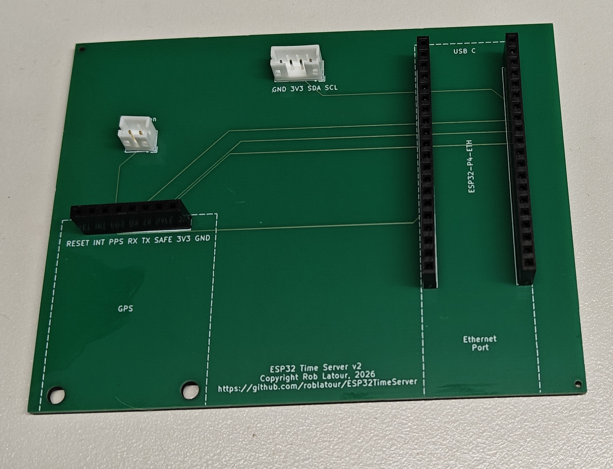

# KiCad PCB Files for ESP32 Time Server

This folder and its sub-folders contain the KiCad files used to create the ESP32
Time Server's PCB.

> **Important:**
>
> **This PCB is compatible with a Waveshare ESP32-P4-ETH development board
> (or its POE variant) when the GPIO pin defaults for ESP32TimeServer v2.4
> and beyond are used.**
>
> Special thanks to gitbub user **TMW2N** who updated the PCB files
> in this repository for use with ESP32TimeServer v2.4 and beyond.
> 

The BOM components part numbers needed to order this board via JLCPBC are as
follows:

| Item                           | Qty | JLCPCB Part Number | Url                                                                |
| ------------------------------ | --- | ------------------ | ------------------------------------------------------------------ |
| 20 pin socket for ESP32-P4-ETH | 2   | C2905423           | https://jlcpcb.com/partdetail/3175197-KH_2_54FH_1X20P_H85/C2905423 |
| 8 pin socket for GPS           | 1   | C2905417           | https://jlcpcb.com/partdetail/3175191-KH_2_54FH_1X8P_H85/C2905417  |
| connector for LCD:             | 1   | C566011            | https://jlcpcb.com/partdetail/JST-B4B_PH_K_SGW/C566011             |
| connector for button:          | 1   | C5251182           | https://jlcpcb.com/partdetail/JST-B2B_PH_K_SGW/C5251182            |

Also, when looking at the other photos of the PCB with the components (below)
don't let colour of the wires of the LCD connector cable confuse you. Ideally
they would have been coloured differently. However, I had that pre-wired cable
connector on hand and I just used it.

The pin markings for the external button connector don't matter, as either pin
can be connected to either terminal of the external button.

 
 

